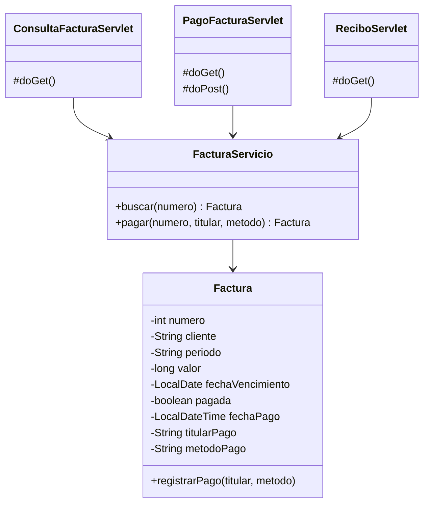

# Artefactos del módulo "Pago de facturas" (servlets y JSP)

Este documento resume los artefactos del ciclo de vida del software en los que se basa el código.

## Historias de usuario

| Código | Historia | Dónde se implementa |
|--------|----------|---------------------|
| HU-01 | Como cliente quiero consultar mi factura por su número para conocer el valor y la fecha de vencimiento. | `ConsultaFacturaServlet` (GET) y `consulta.jsp` |
| HU-02 | Como cliente quiero pagar mi factura en línea indicando el titular y el método de pago para no ir a una oficina. | `PagoFacturaServlet` (GET y POST) y `pago.jsp` |
| HU-03 | Como cliente quiero ver un recibo después de pagar para tener un soporte del pago. | `ReciboServlet` (GET) y `recibo.jsp` |

## Casos de uso

- Actor: Cliente.
- Casos de uso: Consultar factura, Pagar factura, Ver recibo.
- "Pagar factura" incluye "Consultar factura" (primero se busca la factura que se va a pagar).
- "Ver recibo" solo está disponible cuando la factura ya fue pagada.

## Diagrama de clases



## Prototipo (diseño de las pantallas)

1. Consulta: un campo "Número de factura" y el botón Consultar. Debajo aparece la tabla con los datos y el botón "Pagar esta factura".
2. Pago: tabla con factura, cliente y valor; campos "Nombre del titular" y "Método de pago"; botón Confirmar pago.
3. Recibo: mensaje de éxito y tabla con los datos del pago.

## Flujo de la aplicación

```
consulta.jsp --GET /consulta?numero=1001--> ConsultaFacturaServlet --> consulta.jsp (muestra la factura)
consulta.jsp --GET /pago?numero=1001-----> PagoFacturaServlet.doGet --> pago.jsp (formulario)
pago.jsp ------POST /pago---------------> PagoFacturaServlet.doPost --> redirige a /recibo?numero=1001
                                          ReciboServlet.doGet --> recibo.jsp
```
